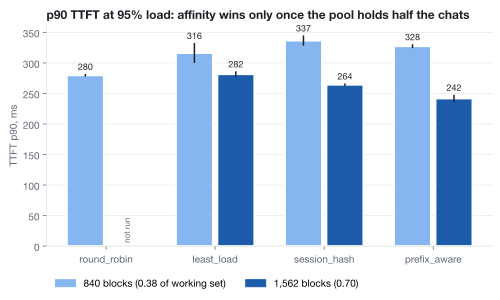

# manifold-serve

An open inference serving platform: cache-aware request routing, workload-class autoscaling, and
canary model deployments for LLM fleets on Kubernetes.

> Serving LLMs is a distributed systems problem. Once you have more than one replica, the
> interesting questions stop being about the model and start being about the fleet: where does
> this request go, how many replicas should exist right now, and how do you ship a new model
> without breaking the ones in flight? `manifold-serve` is a working, measured exploration of those
> questions on real hardware, at a budget an individual can afford.

Built in public. Every design decision ships with a benchmark. Writeups are published separately.

## Architecture

```
                        +----------------------------+
   clients  ──────────► │  router (data plane)       │
   (OpenAI-compatible)  │  filter, score, pick:      │
                        │  round_robin, least_load,  │
                        │  session_hash, prefix_aware│
                        +-------------+--------------+
                                     │
                 ┌───────────────────┼───────────────────┐
                 ▼                   ▼                   ▼
          +-------------+    +-------------+     +-------------+
          | vLLM replica|    | vLLM replica|     | vLLM replica|
          |  (GPU 0)    |    |  (GPU 1)    |     |  (spot)     |
          +-------------+    +-------------+     +-------------+
                 ▲                   ▲                   ▲
                 └────────── autoscaler (control plane) ─┘
                    scales on queue depth, tokens in flight,
                    KV-cache utilization; workload classes with
                    priority + preemption; scale-to-zero on spot
```

## Roadmap

- [x] **M0** (done 2026-09): Serve Qwen3.8-27B (NVFP4) with vLLM, async load generator, measured TTFT/TPOT/throughput curves and an MTP speculative-decoding A/B. Three rounds, run records in `bench/m0/runs.md`, `bench/m0-part2/runs.md`, `bench/m0-redux/runs.md`, and `bench/m0-redux/runs-2026-09-24.md`.
- [x] **M1** (in progress): Router v1 with pluggable policies; measured comparison: round-robin vs least-outstanding vs prefix-cache-aware. Measurements in `bench/m1/runs-2026-10-26.md` and, for the dense-model control and the W0 harness check, `bench/m1/runs-2026-11-07-dense.md`. The uncapped-pool run and the W2 control were not run.
- [ ] **M2**: Custom-metrics autoscaler on Kubernetes; interactive vs batch workload classes; scale-to-zero on spot GPUs
- [ ] **M3**: Canary model deployments gated by automated evals, auto-promote/rollback
- [ ] **M4**: Rust port of the router data plane (axum/tokio), side-by-side latency comparison
- [ ] **M5**: Two-region latency-aware routing + failover; fleet-scale discrete-event simulator

## Quickstart

On a laptop, with no GPU: two fake engines (`manifold.sim`, a CPU stand-in for vLLM with a real
prefix cache and vLLM's metric names) behind the router.

```bash
uv sync --extra dev
uv run python -m manifold.sim --port 8001 &
uv run python -m manifold.sim --port 8002 &
MANIFOLD_BACKENDS="http://localhost:8001,http://localhost:8002" \
MANIFOLD_POLICY=prefix_aware \
uv run python -m manifold.router
```

`bench/m1/dryrun-local.sh` runs the whole M1 benchmark pipeline this way, with vLLM's multi-turn
benchmark as the load generator. On a GPU box, `deploy/docker-compose.yml` starts two real vLLM
replicas on ports 8001 and 8002. On RunPod, follow `bench/m1/README.md`.

## Benchmarks

M0 numbers (single replica, no router) live in the `runs*.md` files under `bench/`, with charts
next to them. Raw benchmark output is not in the repository; the scripts in `bench/` run the same
experiments on your own hardware.

M1 compares router policies on two Qwen3.5-9B replicas (vLLM 0.31.0, 2 x RTX PRO 6000) at 95% of
the throughput knee, with a KV pool that holds 0.7 of the working set. Two seeds each; details in
`bench/m1/runs-2026-10-26.md`.

| policy         | TTFT p50 | TTFT p90 | prefix-cache hit rate |
| -------------- | -------- | -------- | --------------------- |
| `least_load`   | 158 ms   | 282 ms   | 0.24                  |
| `session_hash` | 148 ms   | 264 ms   | 0.38                  |
| `prefix_aware` | 144 ms   | 242 ms   | 0.39 to 0.40          |



## Why "manifold"

A manifold takes one intake and distributes flow across many outlets without losing
pressure. Same job here, with tokens.

## License

MIT