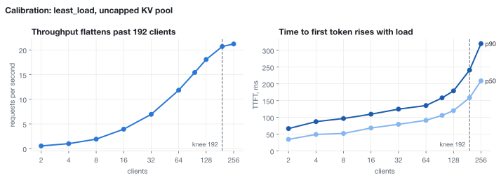
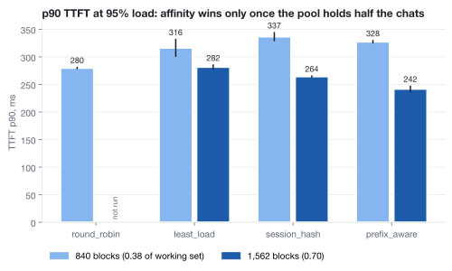
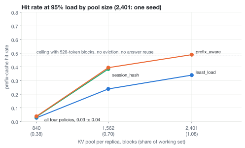

# M1, routing-policy comparison on two replicas: Qwen3.5-9B, 2026-10-23 to 2026-10-26 (UTC)

Two vLLM replicas serve ShareGPT multi-turn chat through the manifold router at 95% of the
throughput knee. With a KV pool that holds 0.7 of the working set, `prefix_aware` lowered p90
TTFT from 282 ms to 242 ms against `least_load` (two seeds each, ranges do not overlap). The first
pressure run sized its pools in tokens, which on this hybrid model gave a pool of 0.38 of the
working set and a hit rate of 0.03 for every policy. That run is kept below as a record.

## Environment

- Modal, 2 x NVIDIA RTX PRO 6000 (96 GB), one replica per GPU, 16 cores, 64 GiB.
- `Qwen/Qwen3.5-9B` at `c202236235762e1c871ad0ccb60c8ee5ba337b9a`, `--language-model-only`.
- vLLM 0.31.0, prefix caching on, `mamba_cache_mode` `align`, `--max-model-len 32768`,
  `--max-num-batched-tokens 8192`, `--max-num-seqs 512`, `--gpu-memory-utilization 0.90`,
  thinking off.
- Workload: 4,000 converted ShareGPT conversations, vLLM `benchmarks/multi_turn` at v0.31.0.
  `MATRIX_ACTIVE=384`; the bench gives each client a whole number of conversations, so 182
  clients run 364 live conversations.
- Router overhead p50 +2.6 to +3.0 ms. First 60 s of each cell cut as warmup.

## KV pool accounting

Qwen3.5-9B has 8 attention layers and 24 Gated DeltaNet layers. vLLM uses one 528-token block
for both and splits the layers into four groups (`kv cache group sizes [528, 528, 528, 528]`).
A live conversation holds its context blocks (mean 2.81) plus one state block per DeltaNet group
(3), 5.81 blocks in total. Running requests held 5.7 to 5.8 blocks each at every pool size,
measured from 1 s samples of KV usage and running count. The working set is 384 x 5.81 = 2,232
blocks per replica. `size_kv.py` sizes pools in blocks since `91686e9`.

| pool per replica | blocks | share of working set | run |
|---|---|---|---|
| pressure, sized in tokens | 840 | 0.38 | `m1-2026-10-26` |
| pressure, sized in blocks | 1,562 | 0.70 | `m1-2026-10-26-blocks` |
| fits, sized in tokens | 2,401 | 1.08 | `m1-2026-10-26` |
| uncapped (calibration) | 4,025 | 1.80 | `calib` |

A fits pool of 2.0 x the working set (4,464 blocks) is larger than the card.

## Calibration

`least_load`, uncapped pool. Throughput flattens at 20.7 req/s at 192 clients (21.2 at 256), so
the knee is 192 and 95% load is 182 clients.

## Results at 95% load

| pool | policy | seeds | TTFT p50 ms | TTFT p90 ms | hit rate |
|---|---|---|---|---|---|
| 1,562 | `least_load` | 2 | 158 (157-159) | 282 (277-286) | 0.24 |
| 1,562 | `session_hash` | 2 | 148 (148-148) | 264 (262-266) | 0.38 |
| 1,562 | `prefix_aware` | 2 | 144 (143-146) | 242 (236-248) | 0.39 to 0.40 |
| 840 | `round_robin` | 2 | 163 (159-167) | 280 (278-282) | 0.03 |
| 840 | `least_load` | 2 | 183 (175-190) | 316 (300-333) | 0.03 |
| 840 | `session_hash` | 2 | 185 (182-187) | 337 (328-345) | 0.04 |
| 840 | `prefix_aware` | 2 | 179 (178-180) | 328 (324-331) | 0.04 |
| 2,401 | `least_load` | 1 | 149 | 238 | 0.34 |
| 2,401 | `prefix_aware` | 1 | 145 | 212 | 0.49 |

At 70% load (134 clients) and 840 blocks, one seed: `least_load` 266 ms p90, `prefix_aware` 271.

- With 528-token blocks, a cache with no eviction could serve 0.68 to 0.70 of prompt tokens in
  these cells; with 16-token blocks it would be 0.93 to 0.94. 52 to 54% of prompts are shorter
  than one block and cannot hit.
- Router decision logs at 1,562 blocks: `prefix_aware` never chose the replica with fewer matched
  blocks (0 of 3,090 decisions) and moved 22 to 23% of turns, all with no full block cached.
  `session_hash` moved none. The p90 gap in in-flight requests between the replicas was 22 to 24
  for `prefix_aware` and 46 to 50 for `session_hash`.

## Protocol problems

- The bench stops all clients when the first one finds the conversation queue empty, so
  completed requests per cell (3,363 to 5,940) differ by policy. Compare latency, not
  throughput.
- vLLM's default `max_num_seqs` of 1024 exceeds the 840 state blocks of the small pool, and
  replica A refused to start. Fixed with `--max-num-seqs 512` (`c6f3a66`).
- One cell exited after 10 s when an idle replica's `/metrics` did not answer. Scrapes now retry
  (`04ebf6c`) and the cell was rerun.

## Not run

The uncapped pool (4,025 blocks) for `least_load` and `prefix_aware`, the dense control
(Qwen3-8B), `round_robin` and 70% load at 1,562 blocks, and a third seed.

## Charts

`charts/*.{svg,png}` are drawn from each run's `summary.csv`, written by
`uv run bench/m1/summarize.py <run dir> --warmup-s 60`. Raw results are not in the repository.
