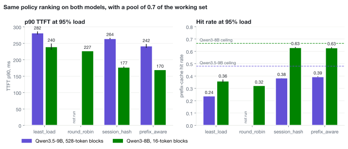

# M1, dense control: Qwen3-8B, 2026-11-07 (UTC)

The same routing comparison as `runs-2026-10-26.md`, on a dense model with 16-token blocks and no
recurrent state. At 95% of the knee, with a KV pool that holds 0.7 of the working set,
`prefix_aware` lowered p90 TTFT from 240 ms to 170 ms against `least_load` (two seeds each, ranges
do not overlap). The gain on Qwen3.5-9B was 282 ms to 242 ms. The policy ranking is the same on
both models, and the gain is larger on the dense model. The gap between `prefix_aware` and
`session_hash` shrinks from 22 ms to 7 ms.

## Environment

- Modal, 2 x NVIDIA RTX PRO 6000 (96 GB), one replica per GPU, 16 cores, 64 GiB.
- `Qwen/Qwen3-8B` at `b968826d9c46dd6066d109eabc6255188de91218`.
- vLLM 0.31.0, prefix caching on, `--max-model-len 32768`, `--max-num-batched-tokens 8192`,
  `--max-num-seqs 512`, `--gpu-memory-utilization 0.90`, thinking off.
- Workload, client counts and request counts as in `runs-2026-10-26.md`: 182 clients and 364 live
  conversations at 95% load, 134 clients and 402 at 70%.
- Router overhead p50 +2.85 ms. First 60 s of each cell cut as warmup.

## KV pool accounting

The serve log has no attention block size line, so the block is vLLM's default of 16 tokens. A
token costs 147,463 bytes, and the uncapped pool is 30,937 blocks (495,000 tokens) per replica.
The working set uses the Qwen3.5-9B calibration's conversations: 76.38 blocks x 384 live
conversations = 29,331 blocks, so the uncapped pool holds 1.05 of the working set.
The pressure pool is 0.7 x 29,331 = 20,532 blocks (45.12 GiB).

## Calibration

`least_load`, uncapped pool, one conversation per client, as on Qwen3.5-9B. Client counts were
kept because throughput stays within 4% of Qwen3.5-9B's at 192 and 256 clients.

| clients | req/s | Qwen3.5-9B req/s | TTFT p50 ms | TTFT p90 ms | hit rate |
|---|---|---|---|---|---|
| 64 | 11.85 | | 75 | 105 | 0.63 |
| 96 | 14.76 | | 90 | 127 | 0.62 |
| 128 | 16.86 | 18.06 | 100 | 146 | 0.61 |
| 192 | 19.83 | 20.70 | 130 | 184 | 0.61 |
| 256 | 21.08 | 21.21 | 169 | 240 | 0.59 |

No level crossed the 1,000 ms SLO or showed a growing queue.

## Results

| load | policy | seeds | TTFT p50 ms | TTFT p90 ms | hit rate | prefill mean ms | errors |
|---|---|---|---|---|---|---|---|
| 95% | `prefix_aware` | 2 | 124 (123-125) | 170 (170-170) | 0.63 | 71 | 0 |
| 95% | `session_hash` | 2 | 126 (123-129) | 177 (175-179) | 0.63 | 72 | 1 |
| 95% | `round_robin` | 1 | 131 | 227 | 0.32 | 81 | 0 |
| 95% | `least_load` | 2 | 139 (137-140) | 240 (230-249) | 0.36 | 85 to 92 | 0 |
| 70% | `prefix_aware` | 1 | 103 | 154 | 0.58 | 62 | 0 |
| 70% | `session_hash` | 1 | 104 | 158 | 0.58 | 64 | 1 |
| 70% | `round_robin` | 1 | 109 | 196 | 0.28 | 71 | 0 |
| 70% | `least_load` | 1 | 115 | 210 | 0.30 | 77 | 0 |

Comparison at 95% load and 0.7 of the working set, two seeds per policy:

| | Qwen3.5-9B | Qwen3-8B |
|---|---|---|
| block | 528 tokens | 16 tokens |
| `least_load` p90 ms, hit rate | 282, 0.24 | 240, 0.36 |
| `session_hash` p90 ms, hit rate | 264, 0.38 | 177, 0.63 |
| `prefix_aware` p90 ms, hit rate | 242, 0.39 to 0.40 | 170, 0.63 |
| `prefix_aware` gain over `least_load`, p90 | 40 ms (14%) | 70 ms (29%) |
| `prefix_aware` gain over `session_hash`, p90 | 22 ms | 7 ms |
| hit-rate ceiling, previous prompt only | 0.47 to 0.48 | 0.66 to 0.67 |
| turns `prefix_aware` moved to the other replica | 0.22 to 0.23 | 0.04 to 0.05 |

Absolute TTFT is not a comparison of the two models. Only the routing gains are.

- Limiter: `waiting` was 0 and queue time 0.01 ms in every cell, and mean KV usage was 0.29. The
  gain appears in prefill, whose mean fell from 85 to 92 ms to 71 ms at 95% load. GPU compute is
  the likely limiter, as profiled on Qwen3.5-9B on 2026-10-23. It was not profiled on this model.
- Router wait p50 / p90 was 3.5 to 4.0 / 9.3 to 11.6 ms, so 16-token hashing did not slow the
  router.
- Both errors are `ConnectTimeout` from router to replica, 2 of 55,085 requests.
- `prefix_aware` chose the replica with fewer matched blocks in 135 of 4,788 decisions, and 2% of
  its requests spilled. On Qwen3.5-9B the first count was 0 of 3,090.
- At p90 the in-flight gap between replicas was 27 to 32 for `prefix_aware`, 20 to 36 for
  `session_hash` and 14 for `least_load`.

## Answers do not enter the prefix cache

With thinking off, both models' chat templates end a prompt in `<think>\n\n</think>\n\n`, and the
next turn renders the previous answer without that block. The two prompts diverge at the first
character of the answer, so a turn reuses the previous prompt and not the previous answer, even
though the answer's blocks are in the cache. Rendering both templates on 2026-11-07 confirmed
this.

The ceilings of 0.68 to 0.70 and 0.93 to 0.94 in the first version of `runs-2026-10-26.md` assumed
answers could be reused. Without them the ceilings are 0.46 to 0.49 with 528-token blocks and 0.66
to 0.67 with 16-token blocks. Measured hit rates under affinity reach 0.63 on Qwen3-8B and 0.40
on Qwen3.5-9B, and the uncapped calibration reaches 0.63.

## Protocol problems

- Modal cancelled the call at 07:46:35 during `prefix_aware` at 70% load. The logs show no failure,
  timeout or preemption, and stopping the local client in three test calls did not reproduce it.
  The cause is unknown. The partial cell was moved aside and the rerun completed.
- 95% load is the primary model's knee. This model's throughput was still rising 6% from 192 to 256
  clients, against 2.5% on Qwen3.5-9B, so its load may be slightly below 95%.

## W0 harness control

W0 replays ShareGPT first turns only, so no conversation has a prefix to reuse. The spec requires
no `prefix_aware` gain here. The pass rule was set before the results were read: every hit rate
under 0.05, and `prefix_aware` p90 no more than 15 ms below `least_load`. W0 passed.

Run `m1-2026-11-07-w0`: Qwen3.5-9B, 1,562 blocks, 134 clients, one seed, 3,350 requests asked for.

| policy | records | hit rate | TTFT p90 ms, after 60 s | TTFT p90 ms, whole cell | errors |
|---|---|---|---|---|---|
| `prefix_aware` | 2,449 | 0.00 | 81 | 94 | 0 |
| `least_load` | 2,261 | 0.01 | 81 | 97 | 0 |
| `round_robin` | 2,499 | 0.00 | 84 | 95 | 0 |
| `session_hash` | 2,155 | 0.00 | 85 | 98 | 0 |

- The cells ran 74 to 89 s, so the 60 s warmup cut leaves 23 to 40 s. The whole-cell column is there
  for that reason. It gives the same verdict.
- First turns average 56 tokens, far below the 528-token block, so `prefix_aware` has no match to
  act on and routes by load. W0 therefore shows that the harness gives `prefix_aware` no advantage
  without cache hits. It does not test routing on short prefixes.
- The matrix's 7,690 requests would fail W0, because one-turn conversations run out near 30 per
  client and no client would reach its quota of 57. `controls.sh` now sets `NREQ=3350`.

## Not run

`round_robin` at a second seed. Qwen3.5-9B has no cells at 70% load or `round_robin` at 1,562
blocks under W1, so those dense cells have no comparison. The uncapped pool, the third seed and
the W2 control were not run on either model.
