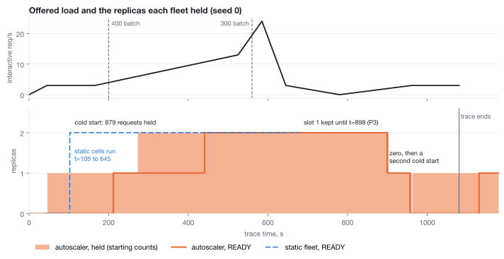
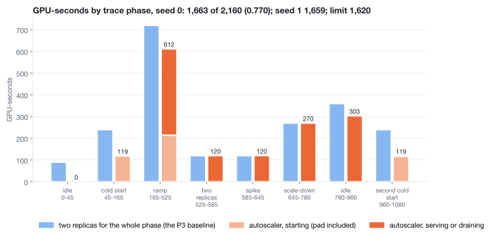
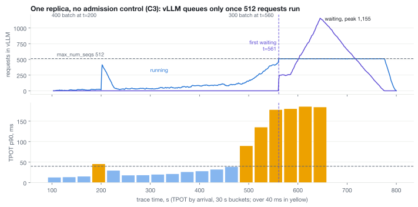
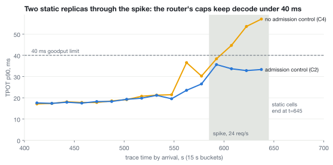

# M2, autoscaler on two replicas: Qwen3.5-9B, 2026-11-08 (UTC)

All seven cells ran on Modal, C5 twice. Six of eight rules passed, and two failed: P3 (GPU-seconds,
0.770 against a limit of 0.75) and P6 (vLLM's `waiting` metric as a scaling trigger). On one synthetic
trace, the autoscaler held 77% of the GPU-seconds of a static two-replica fleet. From the moment the
cold-start backlog cleared, its interactive goodput was within 1.3 points of the static fleet. The cost
is the cold start: 861 to 879 interactive requests waited for the first engine, up to 173 s.

## Claims

Allowed, with this run as evidence:

- On one synthetic trace on two RTX PRO 6000, one Python policy held 77.0% (C1) and 76.8% (C6) of the
  GPU-seconds of a static two-replica fleet. Interactive goodput from backlog clear to t=585 was 99.8%
  and 98.7%, at 0.0 and 1.3 points below the static fleet of the same seed. The cold-window row below
  goes next to this claim.
- The policy scales real vLLM engines, drains them, reaches zero and serves the first request.
- Under an injected reclaim, after the router fix in `2956e9d`, no batch or unstarted interactive
  request was lost.

Not allowed:

- That autoscaling was measured on Kubernetes. Manifests and the Kubernetes adapter are checked
  against a fake API server only; pods, probes and PriorityClass eviction are a separate step on kind.
- That the invoice fell. The 2-GPU container is billed for the whole run. The saving is GPU-seconds an
  engine held, priced at $3.03 per GPU-hour.
- That spot reclaim was real. It is injected, in the shape of Modal's 30 s grace.
- Anything about node provisioning or GPU scheduling. Nothing here exercises them.
- Any number from one seed as a general result. C1 and C6 are two runs of one trace.

## Environment

- Modal, 2x RTX PRO 6000, $7.33/h for the container. Three apps, all on 2026-11-08 UTC:
  `ap-t736rFlEstrM4AbZ8hMXp0` 01:47 to 03:19 (91 min, about $11.15, probe and C1 to C7),
  `ap-osbs8rqVD9NSe0ZJKxBYTE` 03:19 to 03:28 (9 min, about $1.10, C5 again),
  `ap-CHr5OCjNXCeXl8xqqx7Zwz` 03:35 to 03:44 (9 min, about $1.10, C5 after the router fix).
  About $13.35 in all, computed from the app times.
- vLLM 0.31.0, `Qwen/Qwen3.5-9B` at `c202236235762e1c871ad0ccb60c8ee5ba337b9a`, `--max-num-seqs 512`,
  `--max-model-len 32768`, `--max-num-batched-tokens 8192`, `--gpu-memory-utilization 0.90`.
- Repo at `694eb94` for the probe and C1 to C7, `2956e9d` for the C5 that counts (each cell's `env.json`).
- Router: prefix_aware, caps 96 interactive and 64 batch per replica, hold 330.2 s (2 x S) and 900 s,
  3 attempts, down 5 s.
- Spec (C1): `target_interactive` 27, `batch_rps_per_replica` 9, `batch_deadline_s` 600,
  `up_window_s` 10, `settle_s` 60, `down_window_s` 120, `down_ratio` 0.7, `idle_to_zero_s` 165.1,
  `drain_deadline_s` 30.

## Protocol

- Start cost: S_FIRST 165.1 s, S_RESTART 55.7 s, START_PAD_S 109.4 s (`probe.env`). Every start in a cell
  sleeps the pad, so it costs what a first start in a fresh container costs. The pad counts as
  GPU-seconds held. Warm cells start their engines without the pad, then pay it on any later start.
- Probe checks: cancel ok (running fell to 0 in 0 s), drain ok (a stream finished after SIGTERM).
- Trace: `trace.json`. Open loop, Poisson, 384 live ShareGPT sessions, one seed per cell, requests
  identical across cells of a seed. History uses the dataset's answers, not the model's, so prefix
  hits stop at the previous prompt. max_tokens is the dataset answer length in characters over 4.
- Goodput: share of interactive requests with status 200, TTFT at or under 500 ms and TPOT at or under
  40 ms, at the client, hold time included.

## Deviations

- The P2 window starts when the cold-start backlog clears (t=279 in C1, t=272 in C6), not at t=165.
  This was decided before the run, because at S = 165 s the cold start alone costs about 9 points. The
  figure from t=165 is printed beside the verdict: 89.4% in both seeds.
- C5 failed to start in the main run: C4's router still held its port 2 s after C4 ended. Each cell now
  waits up to 30 s for its ports (`2956e9d`). C5 was rerun alone in a new container, reusing the probe.
- That rerun failed P7 with 2 batch requests lost. The router granted them to slot 1 in the same second
  the reclaim's SIGTERM landed, vLLM refused them with HTTP 500, and the router passed the 500 through.
  The router now replays a 5xx that arrives before any byte (`2956e9d`). C5 was run a third time on that
  commit, and that run is the one in the results. The failed one is kept as
  `c5-reclaim.before-replay-fix`.
- `985e481` then stopped a 5xx from marking the replica down, so one bad request cannot take a replica
  out. No cell ran on it. For a replica that is shutting down, both versions replay the request.
- C7 ran: the 95-minute cap left 10.4 minutes for it after C6.

## Results

`summary.txt`:

```
Rules
P1 PASS: requested at 5.98 req/s, t=272; limit 8.5
P2 PASS: goodput t=279 to 585 99.8%, baseline 99.8%, gap 0.0 points; from t=165 with the cold backlog 89.4%, 174 cold-window requests apart
P3 FAIL: 1663 of 2160 GPU-seconds, 0.770; limit 0.75; $0.42 of engine time at $3.03/GPU-hour
P4 PASS: spike p90 TPOT C2 33.9 ms, C4 52.8 ms; limit 40.0
P5 PASS: 1279 of 1279 completed, maximum interactive wait 172.9 s; limit 180.1 s
P6 FAIL: 7 of 19 30 s buckets over 40.0 ms, 4 of them with waiting above 0; first slow t=180, first waiting t=561
P7 PASS: batch lost 0, unstarted interactive lost 0, truncated 0; slot back 168.7 s after the engine exited, 183.2 s after the reclaim; limit 180.1 s
P8 PASS: slot 1 took 60.2% of 830 requests in the 60 s after READY; limit 30.0%

C6 against C1
P1 AGREE: C1 PASS, C6 PASS
P2 AGREE: C1 PASS, C6 PASS
P3 AGREE: C1 FAIL, C6 FAIL
P5 AGREE: C1 PASS, C6 PASS
P8 AGREE: C1 PASS, C6 PASS

Cold window
c1-reconcile-s0: 879 interactive and 400 batch arrived with no slot READY, 1279 of 1279 completed, wait p50 107.5 s, maximum 172.9 s
c6-reconcile-s1: 861 interactive and 400 batch arrived with no slot READY, 1261 of 1261 completed, wait p50 108.5 s, maximum 167.7 s

Backlog after the first cold start, where P2 starts
c1-reconcile-s0: backlog clear at t=279
c6-reconcile-s1: backlog clear at t=272

Harness
c1-reconcile-s0: 6949 requests, goodput 60.0%, shed 0, client errors 0, other status 0, truncated 0, lag p99 32.9 ms, max 46.1 ms
c2-static-2-s0: 6029 requests, goodput 77.3%, shed 0, client errors 0, other status 0, truncated 0, lag p99 34.9 ms, max 42.0 ms
c3-static-1-blind-s0: 6029 requests, goodput 47.4%, shed 0, client errors 0, other status 0, truncated 0, lag p99 31.3 ms, max 39.5 ms
c4-static-2-blind-s0: 6029 requests, goodput 84.8%, shed 0, client errors 0, other status 0, truncated 0, lag p99 36.7 ms, max 49.1 ms
c5-reclaim: 3504 requests, goodput 97.2%, shed 0, client errors 0, other status 0, truncated 0, lag p99 13.5 ms, max 18.7 ms
c6-reconcile-s1: 6904 requests, goodput 58.9%, shed 0, client errors 0, other status 0, truncated 0, lag p99 35.8 ms, max 48.4 ms
c7-static-2-s1: 5961 requests, goodput 75.9%, shed 0, client errors 0, other status 0, truncated 0, lag p99 33.2 ms, max 42.3 ms
```

| rule | text | C1 | C6 |
|---|---|---|---|
| P1 | the second replica is requested below 8.5 req/s of offered interactive load | PASS, 5.98 | PASS, 6.00 |
| P2 | interactive goodput from backlog clear to t=585 is at least 95%, and at most 3 points below C2 | PASS, 99.8%, gap 0.0 | PASS, 98.7%, gap 1.2 (C2) and 1.3 (C7) |
| P3 | GPU-seconds at most 0.75 of 2 x 1080 | FAIL, 0.770 | FAIL, 0.768 |
| P4 | spike phase: C2 p90 TPOT at or under 40 ms, C4 above 40 ms | PASS, 33.9 and 52.8 ms | |
| P5 | cold window: every request completes, maximum wait at or under S + 15 s | PASS, 172.9 s | PASS, 167.7 s |
| P6 | C3: `waiting` stays 0 while TPOT p90 exceeds 40 ms | FAIL | |
| P7 | C5: no batch lost, no unstarted interactive lost, slot back within S + 15 s; truncations reported | PASS, 168.7 s | |
| P8 | slot 1 takes at least 30% of requests within 60 s of READY | PASS, 60.2% | PASS, 61.4% |

C6 agrees with C1 on every rule both cover.

## Findings

The charts are drawn from this run's results.



**P3 fails on scale-down, not on scale-to-zero.** Measured from `ticks.jsonl`, C1 held 1,662.9
GPU-seconds against a limit of 1,620. The excess is 42.9 GPU-seconds, and C6's is 39.3. After the
spike, the load fell below the scale-down line at t=673.5. At 3 req/s, though, the in-flight count
moves between 11 and 25 around the line of 0.7 x 27 = 18.9. Each reading above the line restarted the
120 s window, the last one at t=776.5, so slot 1 stopped at t=898.4 instead of about t=794. Without
those restarts the ratio would be 0.721 in C1 and 0.723 in C6. That figure is inferred from the
recorded ticks, not measured, and the policy was not changed after the run. The second trip to zero
costs about what staying up would have: slot 0 was off for 5 s, and stopping and starting cost about
122 GPU-seconds against 124 for staying READY (inferred). The three start pads hold 328 GPU-seconds of
the 1,663.



**The second cold start finished after the trace ended.** The last request before the idle phase
drained at about t=790. The fleet reached zero at t=955.8, which is 790 + S. Demand returned at t=960.8,
and the slot was READY at t=1,130, after the last arrival at t=1,080. Every request of that phase was
held. It is in the cold-window row and outside P2.

**P6 fails because C3 reached vLLM's limit of 512 running requests.** One replica with no admission
control ran 506 to 512 requests from t=561 to t=775. `waiting` peaked at 1,155, while the KV cache was
only 66% to 76% full (`samples.tsv`). The router had 1,595 interactive requests in flight at t=650. M1
never ran above 143, which is why `waiting` stayed at 0 there. TPOT p90 was already above 40 ms at
t=180, t=480 and t=510 with `waiting` at 0. So a trigger on `waiting > 0` would have fired first at
t=561, 289 s after this autoscaler asked for a second replica, and that replica would have been READY
after the spike ended. The rule fails as written. The finding supports the choice of signal: `waiting`
rises only once a replica hits its sequence cap, well after decode has slowed.



**Admission control alone protects decode under the spike.** With two replicas, the gate held p90 TPOT
at 33.9 ms in the spike, against 52.8 ms without it (P4). Over the whole trace, interactive goodput was
77.3% with the gate and 84.8% without it. The gate holds requests at the router, which raises TTFT for
the held ones.



**Scale-to-zero costs the first minutes.** Over the whole trace, interactive goodput was 60.0% (C1) and
58.9% (C6), against 77.3% and 75.9% for the static fleet. Most of the gap is the cold window: 879 and
861 interactive requests waited a median of 108 s for the first engine. Every one of them completed.

**Reclaim works after the router fix.** In the counted C5, the router replayed 2 requests that failed
before any byte and 23 preempted batch requests. No request was lost. The slot was READY again 168.7 s
after its engine exited, with a 109.4 s pad inside that.

The load generator kept up in every cell: send lag p99 13.5 to 35.8 ms, maximum 49.1 ms. No request was
shed or truncated.

## Protocol problems

- C5's port check failed 2 s after C4 ended, because C4's router had not yet released the port.
  Cost: one cell in the main run and a second container (about $1.10). Fixed in `2956e9d`.
- The router passed vLLM's shutdown 500 through instead of replaying it. Cost: one failed C5 (about
  $1.10). Fixed in `2956e9d` and narrowed in `985e481`.
- Results reach the Volume only when the call ends. The main run ended about 4 minutes before its cap, so the cap left little room.
